# Fusion Desk

All-in-one GNOME Shell 50 extension: one panel with a taskbar, a start menu and desktop widgets.

**Author:** Md Hafijur Rahman ([Hafij-DEU](https://github.com/Hafij-DEU)) · **Source:** https://github.com/Hafij-DEU/Fusion-desk-gnome-extension · **License:** GPL-2.0-or-later (see [LICENSE](LICENSE))

## Screenshots
| | |
|---|---|
| 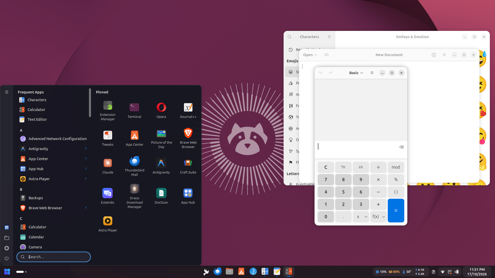 | 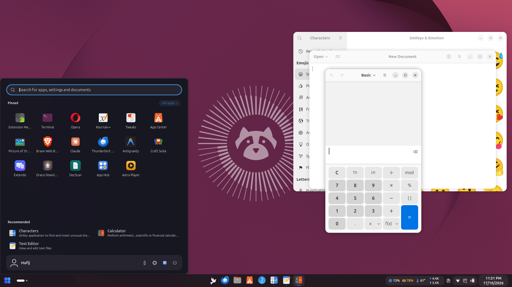 |
| 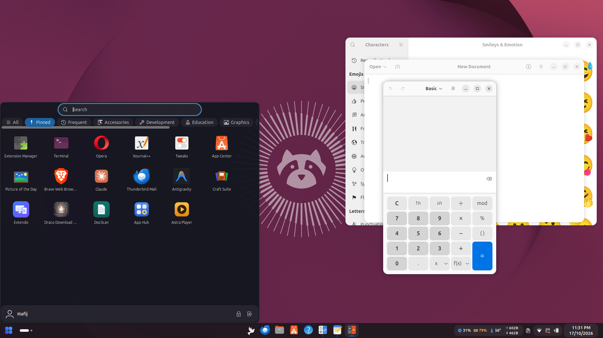 | 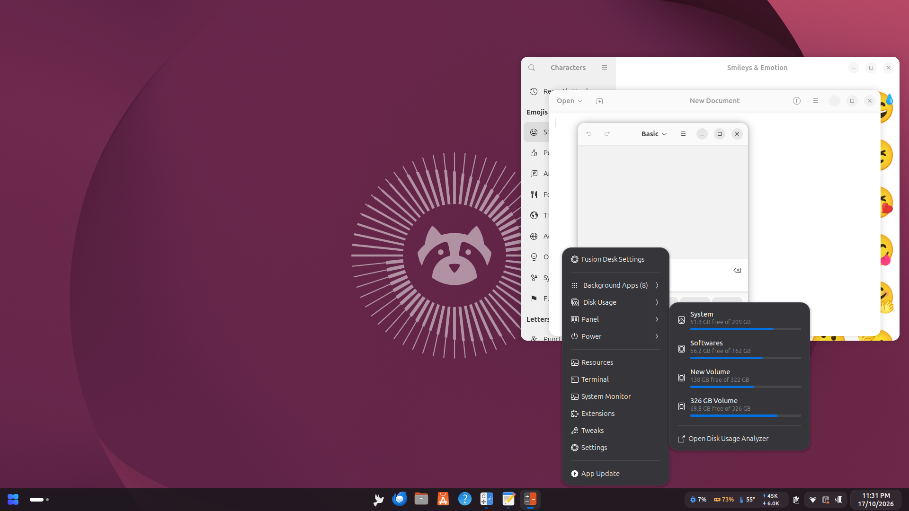 |
| 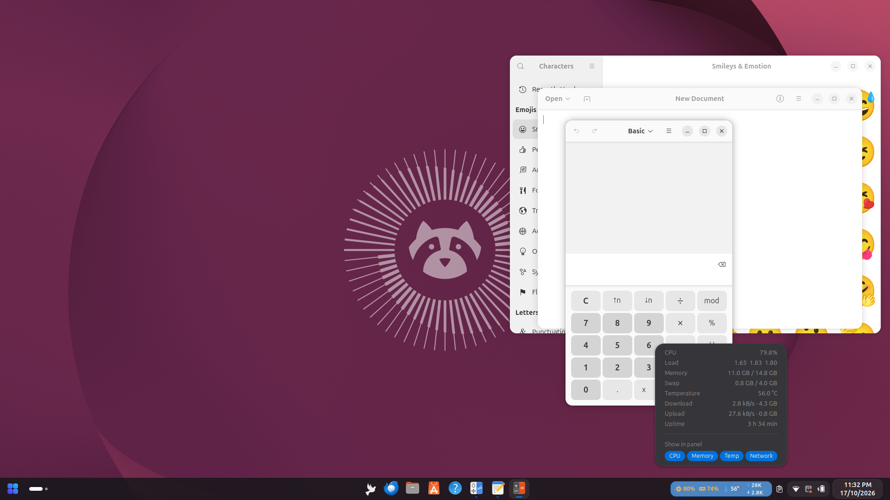 | 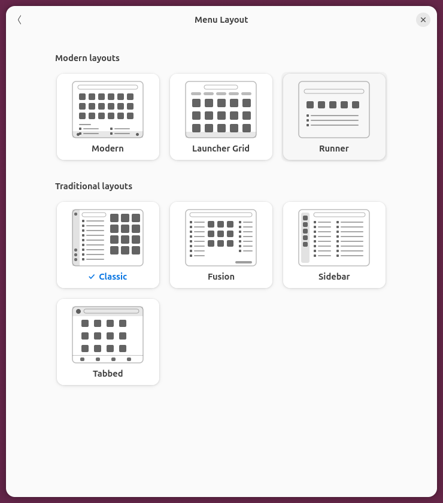 |
| 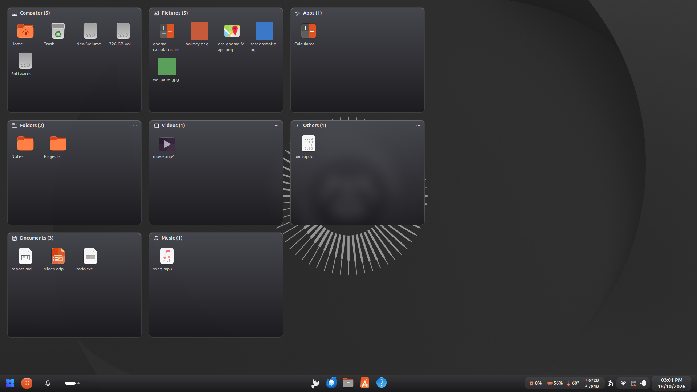 | 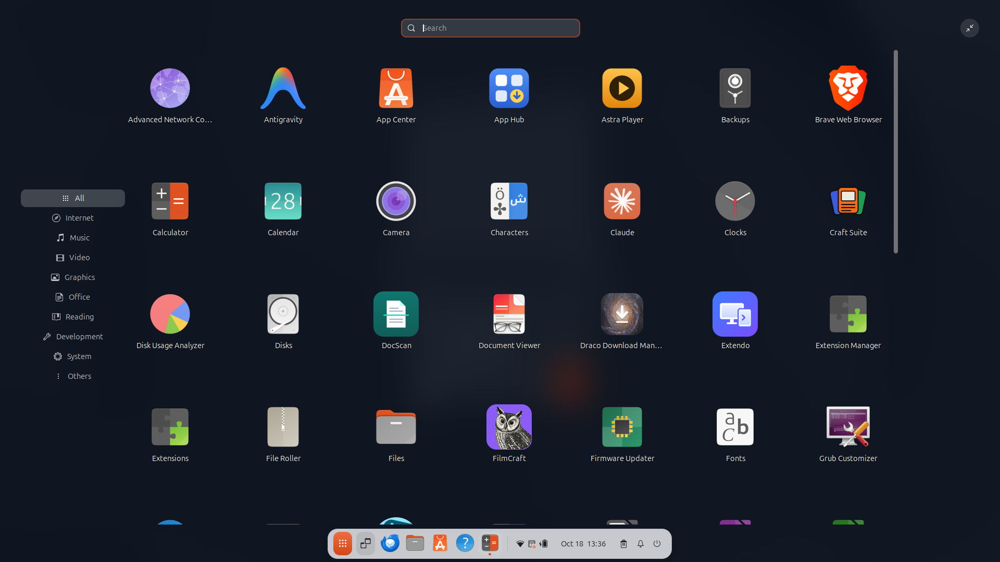 |
| 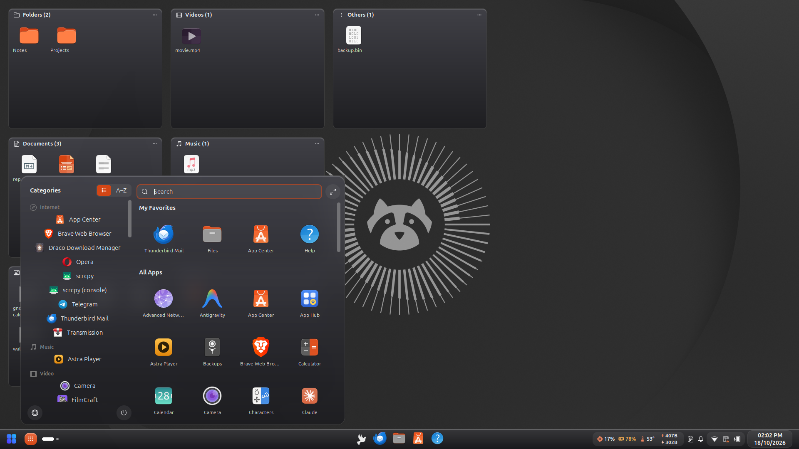 | 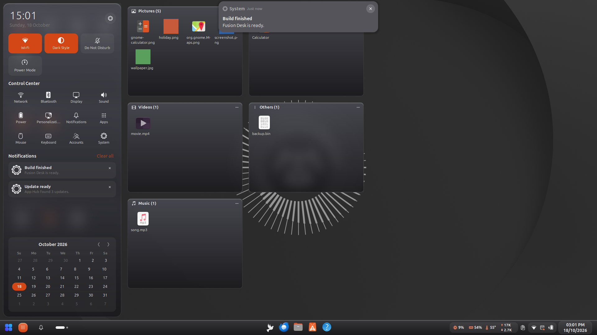 |
| 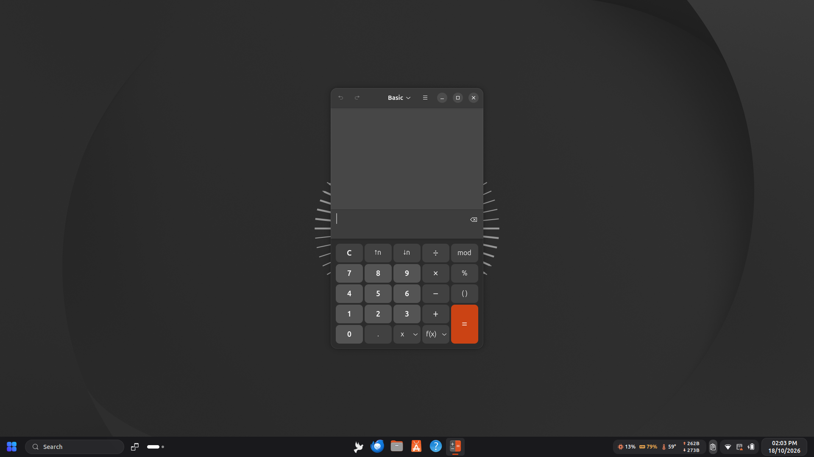 | 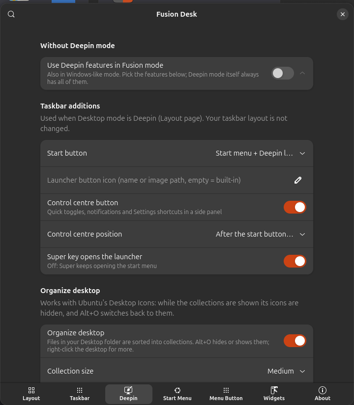 |
| 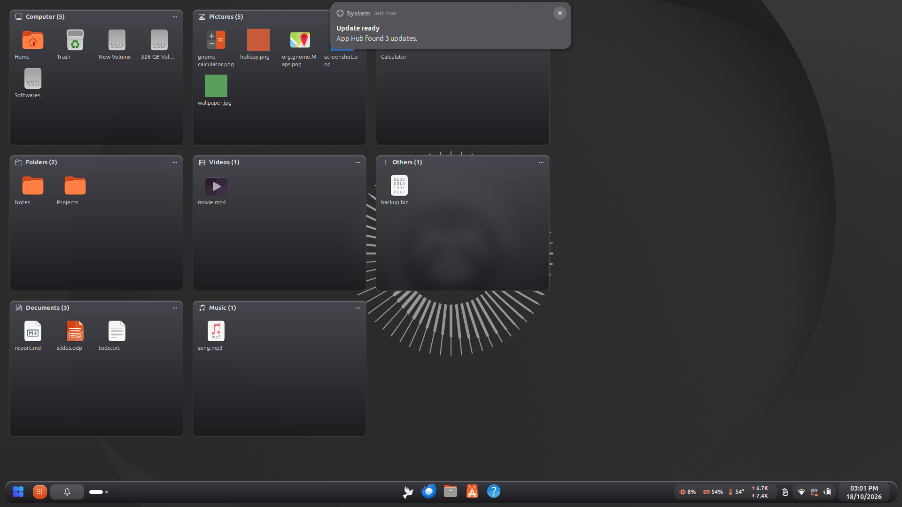 | |

## Features
- **Desktop modes**: Settings → Layout → *Desktop mode*, or right-click the panel → *Desktop mode*. Switches live, no logout. Your taskbar (layout, widgets, size, style) stays exactly as you set it up; a mode only adds features, icons and theming.
  - **Fusion**: the taskbar described below, nothing added.
  - **Windows-like** (options on the *Taskbar* page): a search box (or icon) and a Task View button right after the start button, rounded Windows-style hover tiles, blur.
  - **Deepin** (options on the *Deepin* page):
    - **Launcher**: fullscreen blurred app grid with a category rail and search, or a small windowed launcher (category or A–Z list, favourites, all apps). *Start button*: start menu + a Deepin launcher button, one button that opens the Deepin launcher, or one button with the Fusion start menu. Super can open the launcher.
    - **Control centre**: GNOME's own quick toggles, volume and brightness, Settings shortcuts, notifications (own scrolling area, *Clear all*) and a month calendar at the bottom. Its button sits after the start button (panel opens on the left), in the tray, or on the clock (clicking the clock opens it).
    - **Organize Desktop**: files in your Desktop folder sorted into collections (Computer = Home, Trash and drives, folders, documents, pictures, videos, music, apps, others). Move them by the title bar, resize them (small / medium / large or drag the corner), hide or show them with Alt+O, right-click the desktop for *Organize desktop*. Works with Ubuntu's *Desktop Icons*: its icons are hidden on screen while the collections show, and come back with Alt+O.
    - **Look**: glossy glass taskbar and start menu, blur, optional **floating taskbar** (rounded, with a gap from the screen edges, like Deepin's Fashion dock), light / dark / follow-system colours, optional Deepin accent colour and icon / cursor theme while the mode is on (Deepin's own "bloom" icons: `sudo apt install deepin-icon-theme`). Your own accent and themes come back when you leave the mode.
  - **Deepin features without Deepin mode**: Settings → Deepin → *Use Deepin features in Fusion mode* turns on only the parts you pick (launcher, control centre, Organize Desktop, glossy look, floating taskbar, accent colour, icon / cursor theme) in Fusion or Windows-like mode.
- **Panel**: top or bottom, height, opacity, intellihide (overlap modes + edge-pressure reveal), dynamic opacity, hide the overview dash, panels on every monitor, compact spacing for every indicator, and a **Pills** style (default) that groups the tray, clock and system monitor into rounded blocks (or **Flat**).
- **Accent colour**: highlights, system-monitor icons, taskbar indicators and pills follow the system accent colour (Settings → Appearance) and update live.
- **Status icons**: show or hide each system icon one by one (network, Bluetooth, volume, microphone, camera, battery, battery percentage, Night Light, …).
- **Element layout**: every item (start menu, apps button, taskbar, workspaces, media, system monitor, clipboard, App Hub, screenshot, quick settings, date, show desktop, activities, window title) can be shown or hidden, ordered, and placed left, center or right.
- **Taskbar**: pinned + running apps, grouped or one button per window, indicator styles, window previews, app menu on right-click, configurable click / middle-click / scroll actions, tooltips, Super+1…9.
- **Start menu**: 7 layouts (Modern, Launcher Grid, Runner, Classic, Fusion, Sidebar, Tabbed) picked from drawn previews; colour themes and presets; own pinned list or taskbar favourites; app context menu; search with calculator, `>commands`, recent files and web; places, drives and bookmarks; labelled power options; ArcMenu-style Expand page (shortcuts, places, drives with eject, bookmarks); App Hub panel; Super / extra hotkey / Super+R runner; large click area; adjustable space around the menu (0 = flush with the screen corner); one-click import of an existing ArcMenu setup.
- **Widgets**: CPU / RAM / temperature / network monitor, clipboard history (optional Super+V shortcut that works with the icon hidden; paste-on-select is opt-in), media controls (MPRIS, plus a mute/show-window fallback for apps without MPRIS), custom clock, Caffeine with a timer, workspace pills, window title, screenshot button, show-desktop strip.
- **App Hub**: when [App Hub](https://github.com/Hafij-DEU/Application-hub) is installed, Fusion Desk shows its app updates (start-menu panel, optional panel button, *App Update* in the right-click menu). Without App Hub, none of these entries appear.
- **Right-click menu** (panel and start button): Background Apps (every running app, also window-less ones, found from their systemd app units like Resources does; top 10 by memory, quit buttons, *Open Resources*) and Disk Usage (every mounted disk, *Open Disk Usage Analyzer*) as side panels, Panel toggles, Power, quick launchers for Resources, Terminal, System Monitor, Extensions, Tweaks and Settings (each only while installed), and **App Update** (opens App Hub on its Updates page; only while App Hub is installed).
- **Conflict guard**: pauses itself while Dash to Panel is enabled and shows a notification with an *Open Extensions* button.

## Install on a fresh Ubuntu
Needs **GNOME 50** (Ubuntu 26.04). Check yours with `gnome-shell --version`.

1. Download the latest release:
   ```bash
   wget -O fusion-desk.zip "https://github.com/Hafij-DEU/Fusion-desk-gnome-extension/releases/latest/download/fusion-desk@hafij-deu.github.io.shell-extension.zip"
   ```
2. Install it for your user (no sudo needed):
   ```bash
   gnome-extensions install --force fusion-desk.zip
   ```
3. **Log out and log back in.** GNOME on Wayland only loads new extensions at login.
4. Turn off Ubuntu's dock (Fusion Desk has its own taskbar) and turn Fusion Desk on:
   ```bash
   gnome-extensions disable ubuntu-dock@ubuntu.com
   ```
   ```bash
   gnome-extensions enable fusion-desk@hafij-deu.github.io
   ```
5. Open the settings:
   ```bash
   gnome-extensions prefs fusion-desk@hafij-deu.github.io
   ```

If you also use **Dash to Panel** or **ArcMenu**, turn them off (`gnome-extensions disable dash-to-panel@jderose9.github.com`, `gnome-extensions disable arcmenu@arcmenu.com`): they change the same panel and the Super key. Fusion Desk pauses itself while Dash to Panel is on. To bring over an existing ArcMenu setup, use **Settings → Start Menu → Import from ArcMenu**.

Nothing happens after enabling? Make sure user extensions are allowed: `gsettings set org.gnome.shell disable-user-extensions false`, then log out and in again. The graphical way is the **Extension Manager** app (`sudo apt install gnome-shell-extension-manager`).

### What you get out of the box
A fresh install starts with the author's setup:

- Bottom panel, 48 px; start menu, Activities and media controls on the left, taskbar in the centre, system monitor, clipboard, quick settings and clock on the right; panels on every monitor.
- **Classic** start menu (side rail, A–Z list, pinned tiles), dark-blue theme, 700 px tall, 11 pt font, flush against the bottom-left corner, own start-button image, a pinned list (apps that are not installed are skipped).
- System monitor with temperature, refreshed every second; clipboard history remembered after restart (the **Super+V** shortcut and paste-on-select are opt-in: Settings → Widgets → Clipboard history).

Change anything in the settings. To go back to these defaults:
```bash
dconf reset -f /org/gnome/shell/extensions/fusion-desk/
```

### Uninstall
```bash
gnome-extensions uninstall fusion-desk@hafij-deu.github.io
```
Then log out and in, and re-enable Ubuntu's dock with `gnome-extensions enable ubuntu-dock@ubuntu.com`.

### Build from source
```bash
git clone https://github.com/Hafij-DEU/Fusion-desk-gnome-extension.git
cd Fusion-desk-gnome-extension
gnome-extensions pack --force --extra-source=lib --extra-source=icons --extra-source=LICENSE -o dist .
gnome-extensions install --force dist/fusion-desk@hafij-deu.github.io.shell-extension.zip
```

## Credits and design inspiration
Fusion Desk is an independent project written from scratch. No code was copied from the projects below; they inspired the feature set and the look, and their work is gratefully acknowledged:

- [Dash to Panel](https://github.com/home-sweet-gnome/dash-to-panel) by Jason DeRose, Charles Gagnon and contributors (GPL-2.0) — panel/taskbar ideas.
- [ArcMenu](https://gitlab.com/arcmenu/ArcMenu) by Andrew Zaech, LinxGem33 and contributors (GPL-2.0) — start menu layouts and settings structure. Fusion Desk can read an installed ArcMenu's settings once to import them.
- [Vitals](https://github.com/corecoding/Vitals), [Resource Monitor](https://github.com/0ry0n/Resource_Monitor) and GNOME's system-monitor extension — panel readouts.
- [Clipboard History](https://github.com/SUPERCILEX/gnome-clipboard-history) and [Clipboard Indicator](https://github.com/Tudmotu/gnome-shell-extension-clipboard-indicator) — clipboard menu.
- [Caffeine](https://github.com/eonpatapon/gnome-shell-extension-caffeine) — keep-awake toggle and timer.
- [Date Menu Formatter](https://github.com/marcinjakubowski/date-menu-formatter) — custom clock format.
- [Deepin Desktop Environment](https://github.com/linuxdeepin) (GPL-3.0) — launcher, control centre, Organize Desktop and glossy look for Deepin mode. Reimplemented from scratch from the observed behaviour (see [docs/deepin-inventory.md](docs/deepin-inventory.md)); no Deepin code, icons, wallpapers or translations are included.
- [GNOME Shell](https://gitlab.gnome.org/GNOME/gnome-shell) (GPL-2.0-or-later) — the platform and its public extension APIs.
- General desktop conventions (start menus with pinned grids and side rails, tabbed launchers, search launchers) seen in other operating systems and desktops.

Icons: GNOME/Adwaita theme icons; the CPU, RAM, temperature, arrow and Caffeine icons in `icons/` were drawn for this project. The App Hub icon belongs to the App Hub project by the same author.

## Trademarks
All product names are the property of their owners. Microsoft Windows, deepin, KDE Plasma, Linux Mint, macOS / Spotlight and other names are trademarks of their respective owners; Fusion Desk is not affiliated with or endorsed by them, and its layouts use neutral names. Do not ship a start-button icon that copies another company's logo.

## Privacy
- Clipboard history is kept in memory and, with **Remember after restart** (on by default), stored unencrypted in `~/.cache/fusion-desk/clipboard.json` (mode 0600). Entries that password managers mark as secret are never recorded. Use **Private mode** before copying other passwords.
- Web search only runs when you pick that result; the URL is configurable.
- Deepin mode's Organize Desktop only lists the files in your Desktop folder; it opens, shows or trashes a file only when you ask. With a Deepin icon or cursor theme chosen, Fusion Desk switches GNOME's theme while the mode is on and puts yours back when you leave it.
- App Hub actions run your installed `app-hub` command only when you click them (plus a background `app-hub list` check once an hour while the App Hub button is shown).
