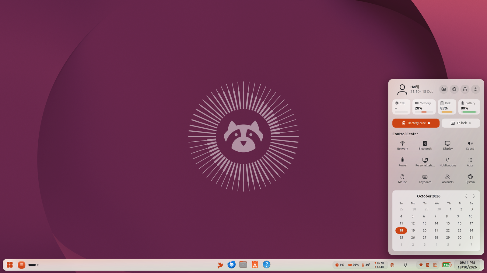
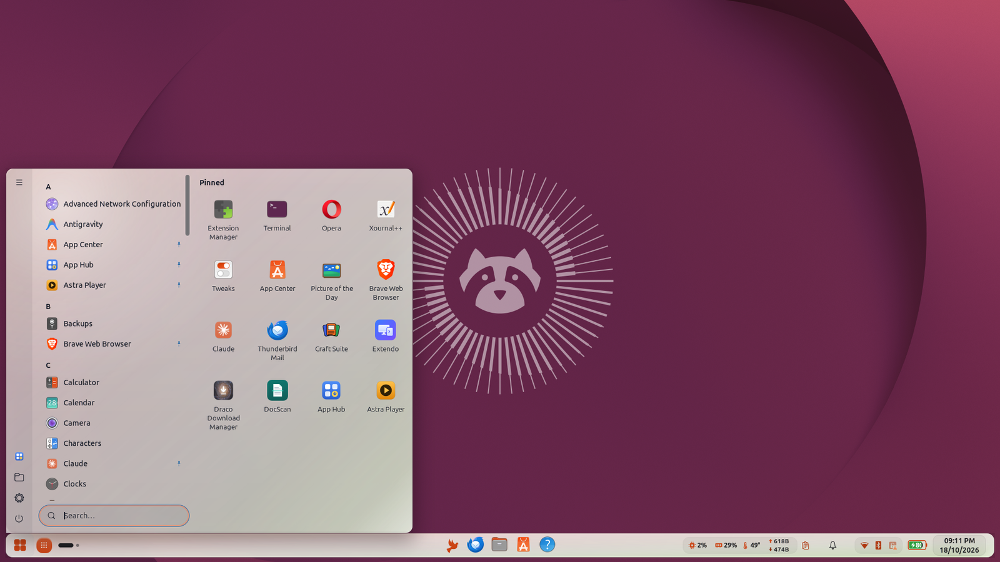
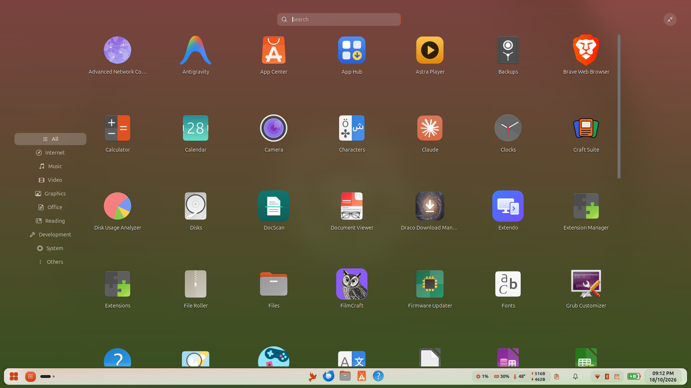
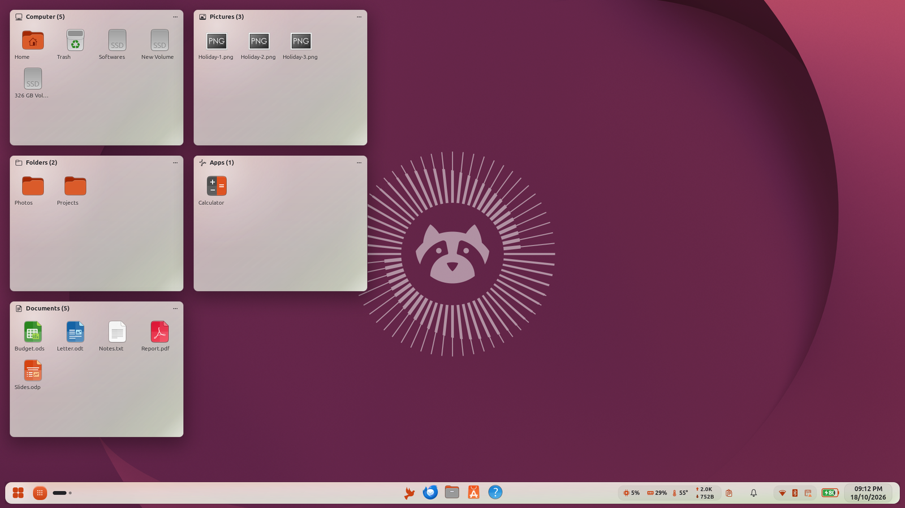
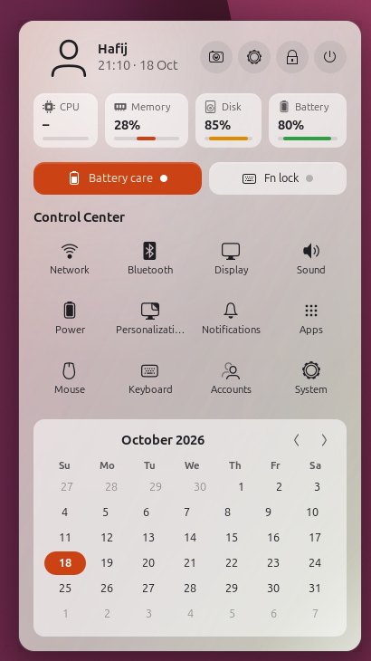
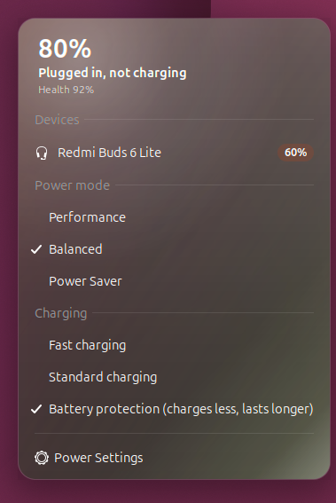
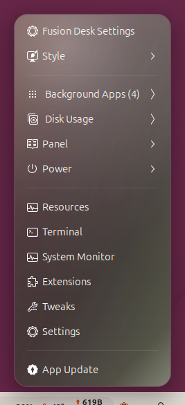
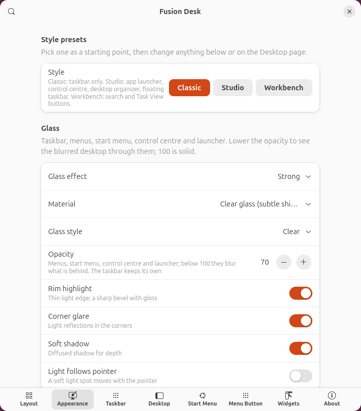
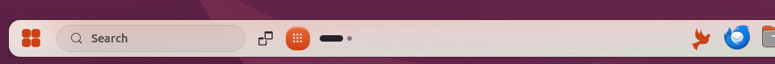

<div align="center">

# Fusion Desk

**One panel for GNOME: taskbar, start menu, control centre, glass look, and the widgets you actually use.**

[](https://release.gnome.org/50/)
[](https://github.com/Hafij-DEU/Fusion-desk-gnome-extension/releases/latest)
[](https://github.com/Hafij-DEU/Fusion-desk-gnome-extension/releases)
[](https://github.com/Hafij-DEU/Fusion-desk-gnome-extension/commits/main)
[](LICENSE)

[Install](#install) · [Features](#features) · [Shortcuts](#keyboard-shortcuts) · [Screenshots](#screenshots) · [Settings](#where-to-find-things) · [FAQ](#faq) · [Contributing](#contributing)



</div>

---

Fusion Desk replaces Ubuntu's dock and GNOME's top bar with **one configurable panel**. It does the work of five or six extensions: taskbar, start menu, system monitor, clipboard history, media controls and more, plus a glass look you can tune or switch off.

<table>
  <tr>
    <td width="33%" valign="top"><b>🪟 Taskbar</b><br>Pinned and running apps, previews, intellihide, floating or full-width, every monitor.</td>
    <td width="33%" valign="top"><b>🚀 Start menu</b><br>7 layouts, search with math and commands, fullscreen app launcher.</td>
    <td width="33%" valign="top"><b>🎛️ Control centre</b><br>Media, meters, notifications, calendar and quick actions in one panel.</td>
  </tr>
  <tr>
    <td valign="top"><b>✨ Glass</b><br>Six styles, two materials, accent gradients, wallpaper blur.</td>
    <td valign="top"><b>🔋 Battery</b><br>Coloured battery, device batteries, power modes, charge limit.</td>
    <td valign="top"><b>🧩 Widgets</b><br>System monitor, clipboard, media, clock, Caffeine, desktop organizer.</td>
  </tr>
</table>

> [!NOTE]
> **New in v17:** dark-mode glass with a dark gradient instead of a white wash, full white text in dark menus, menus that follow light / dark switches, and a new default look. [All releases →](https://github.com/Hafij-DEU/Fusion-desk-gnome-extension/releases)

## Install

**Requires GNOME 50** (Ubuntu 26.04). Check with `gnome-shell --version`.

### One command

This downloads the latest release, installs it for your user (no `sudo`) and turns it on:

```bash
curl -fL https://github.com/Hafij-DEU/Fusion-desk-gnome-extension/releases/latest/download/fusion-desk@hafij-deu.github.io.shell-extension.zip -o /tmp/fusion-desk.zip && gnome-extensions install --force /tmp/fusion-desk.zip && { gsettings get org.gnome.shell enabled-extensions | grep -q "'fusion-desk@hafij-deu.github.io'" || gsettings set org.gnome.shell enabled-extensions "$(gsettings get org.gnome.shell enabled-extensions | sed "s/]$/, 'fusion-desk@hafij-deu.github.io']/; s/^@as \[, /[/")"; }
```

Then **log out and back in**, and turn off Ubuntu's dock (step 4 below). Run the same command again to update.

With [App Hub](https://github.com/Hafij-DEU/Application-hub), install it from **My Apps ▸ Extensions** instead. App Hub also updates it.

### Step by step

1. Download the latest release:

   ```bash
   wget -O fusion-desk.zip "https://github.com/Hafij-DEU/Fusion-desk-gnome-extension/releases/latest/download/fusion-desk@hafij-deu.github.io.shell-extension.zip"
   ```

2. Install it for your user (no `sudo`):

   ```bash
   gnome-extensions install --force fusion-desk.zip
   ```

3. **Log out and back in.** GNOME on Wayland loads new extensions only at login.

4. Turn off Ubuntu's dock, then turn Fusion Desk on:

   ```bash
   gnome-extensions disable ubuntu-dock@ubuntu.com
   ```

   ```bash
   gnome-extensions enable fusion-desk@hafij-deu.github.io
   ```

5. Open the settings, or right-click the panel → **Fusion Desk Settings**:

   ```bash
   gnome-extensions prefs fusion-desk@hafij-deu.github.io
   ```

> [!TIP]
> **Updating:** repeat steps 1–3. Your settings are kept.

## Features

Click a section to expand it.

<details open>
<summary><b>🪟 Panel and taskbar</b></summary>

- Top or bottom, any height and opacity. **Floating** (rounded, with a gap from the screen edges) or full width.
- **Pills** style groups the tray, clock and system monitor into rounded blocks, or choose **Flat**.
- Pinned and running apps, grouped or one button per window. Window previews, indicator styles, and click / middle-click / scroll actions.
- **Intellihide** with edge-pressure reveal, dynamic opacity, and panels on every monitor.
- **Element layout**: show, hide, reorder and place every item left, centre or right.
- A busy right side never squeezes items into "…": the taskbar moves aside instead.
- Optional **search box** and **Task View** button right after the start button.

</details>

<details>
<summary><b>🚀 Start menu and app launcher</b></summary>

- **7 start menu layouts**: Modern, Launcher Grid, Runner, Classic, Fusion, Sidebar and Tabbed, picked from drawn previews.
- Search with a calculator (`12*(3+4)`), commands (`>htop`), recent files and the web (DuckDuckGo, Google, Bing, Brave Search, Startpage, Ecosia, Wikipedia or your own address).
- **Fuzzy app search**: finds apps despite typos or skipped letters (`termnal`, `lbrwrt`), in the start menu, runner and app launcher.
- Places, drives and bookmarks. Labelled power options.
- One-click import of an existing ArcMenu setup.
- **Recommended** (Modern layout): a *Jump back in* row of apps marked **Usually now** (learned from when you open them), **New** and **Recent**, then recent files as cards with picture thumbnails, the app that opens them, and a folder button. Filter by Documents, Images or Media; **More** shows everything grouped by Today, Yesterday, This week and Earlier.
- **App launcher**: a fullscreen blurred grid with a category rail, or a small window. Open it with its own button, the start button or Super.

</details>

<details>
<summary><b>🎛️ Control centre</b></summary>

- Avatar and quick actions: screenshot, Settings, lock, power.
- **Media card** with cover and controls, plus a chip per player when several are playing.
- CPU, memory, disk and battery meters. Battery care and Fn lock switches on laptops that support them.
- **Notifications** take only the room they need. The panel grows with them, then scrolls.
- Month calendar.
- The button can sit after the start button, in the tray, or on the clock.

</details>

<details>
<summary><b>✨ Glass and colours</b></summary>

- **Glass effect** (off / soft / strong) on the taskbar, start menu, Quick Settings, calendar, every panel menu, control centre and launcher.
- **Six styles**: Clear, Frosted, Gel, Tinted, Smoke, Halo.
- **Two materials**: clear glass (subtle shine) or gloss (strong polished shine and bevel).
- **Opacity**: below 100% the desktop shows through, blurred.
- **Dark mode** surfaces get a dark gradient with weaker shine, so bright wallpapers don't wash them out.
- Optional **rim highlight**, **corner glare**, **soft shadow** and a **light that follows the pointer**.
- **Accent gradient** in eight kinds: from the corner, the top, the side or the middle, or blended with a second colour (aurora, sunset, ocean, berry). Strength is adjustable.
- **Accent-coloured icons**: plain white / black tray icons take the accent colour, colourful ones keep theirs.
- **Wallpaper blur** while windows are open, sharp again on an empty desktop.
- **Overview blur**: a blurred wallpaper behind Activities and the app grid, and frosted app folders. One switch and a strength slider (Appearance → Wallpaper).
- **Blurred app windows**: chosen apps (your terminal by default) turn see-through with the desktop blurred behind them. Opacity, strength and the app list are in Appearance → Blurred app windows.
- **Window effects** when windows open and close: **Fire** (burns away from the bottom up, rises from the flames when it opens), **Dissolve** or **Glide**, with an adjustable length (Appearance → Window effects).
- Light / dark taskbar that follows the system style. Optional accent colour, icon and cursor theme while Fusion Desk runs.

</details>

<details>
<summary><b>🔋 Battery and power</b></summary>

- **Coloured battery** with the percentage inside: green when full or charging, accent when normal, orange when low, red when almost empty.
- **Battery button** (optional). Its menu shows:
  - time left or time to full, power draw and battery health
  - **connected devices' batteries** (earbuds show left / right / case when the system reports them)
  - power mode and charging modes
- **Charge limit** (default 90%) stops charging at the level you choose. [How it works ↓](#charge-limit)
- **Charge phones while asleep or off** (laptops with an always-on USB port, e.g. IdeaPads): the USB port stays powered while the laptop sleeps or is shut down. How fast a phone charges is fixed by the port's hardware; no software can raise it.

</details>

<details>
<summary><b>🧩 Widgets and extras</b></summary>

- **Hidden icons arrow** (^): other apps' tray icons tuck away behind an arrow, like Windows. Click an icon to open its app, right-click for its menu, and pin the ones you want on the taskbar under **Taskbar icons**.
- **Picture-in-picture on top**: every app's picture-in-picture window (Firefox, Chrome, Brave, Edge, Opera, Telegram, and players whose mini window is titled like "Player — Picture in picture" or "… - PiP") stays above other windows and on every workspace. It's automatic; add your own titles for apps that name it differently.
- **Always on top apps**: pick apps whose windows always stay above the rest (Settings → System, or right-click an app on the taskbar → Always on top). <kbd>Alt</kbd>+<kbd>Enter</kbd> keeps any focused window on top; press it again to let it go.
- System monitor: CPU, RAM, temperature, network.
- Clipboard history for text and images, with an optional Super+V shortcut. Click an entry and it is pasted straight into the window you were in (Ctrl+Shift+V in terminals). Copied images are saved as files and stay in the history, so you can paste them again later or copy their file path with the link button.
- Media controls, custom clock, Caffeine with a timer, workspaces, window title, screenshot button, show-desktop strip.
- **Desktop files**, in two styles:
  - **Icons**: your Desktop folder as plain desktop icons (plus Home, Trash and drives). Drag each one to any spot and it stays there; double-click to open, right-click for a menu. Right-click the desktop for **New Folder** and **Arrange icons**.
  - **Collections**: files sorted into movable, resizable boxes (Computer, folders, documents, pictures, videos, music, apps, others).

  Either one replaces the Desktop Icons extension: its icons hide while Fusion shows yours.
- **Add to Desktop**: right-click an app in the app grid, dash, taskbar or start menu to put its launcher on the desktop (ready to start with a double click), or take it off again.
- **Right-click menu**: style presets, background apps (with quit buttons), disk usage, panel toggles, power, quick launchers.
- **Style presets**:
  - **Classic**: taskbar only.
  - **Studio**: launcher, control centre, organizer, floating taskbar.
  - **Workbench**: search box and Task View.
  - **Centered**: start button, search box, Task View and apps together in the middle of a flat bottom bar, the control centre at the left edge, tray icons behind the hidden-icons arrow.

  A preset only flips settings; your layout stays (Centered also moves the start button to the middle).
- **Behaviour** (System page): bring apps that ask for attention to the front instead of a "… is ready" notification, hide the workspace switcher popup, and make every animation faster or slower.
- **No duplicates**: if another extension already shows a widget (for example GNOME's system monitor or Caffeine), Fusion Desk hides its own copy.
- **App Hub** integration when [App Hub](https://github.com/Hafij-DEU/Application-hub) is installed.

</details>

## My setup

**Settings → Panel → My setup → Save** stores every Fusion Desk setting in `~/.config/fusion-desk/my-setup.json`. If anything changes later (an update, a reset, a wrong click), **Restore** brings it all back in one click. It's also in the panel's right-click menu under **Style → Restore my setup**. The file is outside GNOME's settings database, so it survives `dconf reset` and reinstalls.

## Keyboard shortcuts

| Shortcut | Action | Setting |
| --- | --- | --- |
| <kbd>Super</kbd> | Start menu, runner, app launcher or Activities | Start Menu → Keyboard |
| <kbd>Super</kbd>+<kbd>R</kbd> | Runner (quick search) | Start Menu → Keyboard |
| <kbd>Super</kbd>+<kbd>1</kbd>…<kbd>9</kbd> | Open or focus the nth taskbar app | Taskbar |
| <kbd>Ctrl</kbd>+<kbd>Super</kbd>+<kbd>1</kbd>…<kbd>9</kbd> | New window of the nth taskbar app | Taskbar |
| <kbd>Alt</kbd>+<kbd>Enter</kbd> | Keep the focused window always on top, or let it go | Any window |
| <kbd>Super</kbd>+<kbd>V</kbd> | Clipboard history (off by default) | Widgets |
| <kbd>Ctrl</kbd>+<kbd>V</kbd> | Sent for you when you pick a clipboard entry (Paste on select) | Widgets |
| <kbd>Alt</kbd>+<kbd>O</kbd> | Hide or show the desktop icons or collections | Desktop |

An extra start menu shortcut (for example <kbd>Super</kbd>+<kbd>Space</kbd>) can be set in **Settings → Start Menu → Keyboard**.

In Settings, each shortcut is shown as keys next to the setting it belongs to, and **About → Keyboard shortcuts** lists them all, including the keys inside the start menu, app launcher and clipboard history.

## Screenshots

<table>
  <tr>
    <td width="50%"><br><sub><b>Start menu</b>: Classic layout with glass</sub></td>
    <td width="50%"><br><sub><b>App launcher</b>: fullscreen with categories</sub></td>
  </tr>
  <tr>
    <td><br><sub><b>Organize Desktop</b>: files sorted into collections</sub></td>
    <td><br><sub><b>Modern layout</b>: dark theme</sub></td>
  </tr>
</table>

<table>
  <tr>
    <td align="center"><br><sub><b>Control centre</b></sub></td>
    <td align="center"><br><sub><b>Battery menu</b></sub></td>
    <td align="center"><br><sub><b>Right-click menu</b></sub></td>
  </tr>
</table>

<table>
  <tr>
    <td width="50%"><br><sub><b>Settings</b>: style presets and glass</sub></td>
    <td width="50%"><br><sub><b>Settings</b>: start menu layouts</sub></td>
  </tr>
</table>

<p align="center"><br><sub><b>Search box and Task View</b> (Workbench preset)</sub></p>

## Where to find things

Settings pages: **Panel · Appearance · Taskbar · Start Menu · Desktop · Widgets · System · About**.

| I want to… | Go to |
| --- | --- |
| Move the panel, change its height, opacity or make it float | **Panel** → Panel |
| Reorder or hide panel items | **Panel** → Elements |
| Show the battery as its own button, set a charge limit | **System** → Battery / Charge limit |
| Pick a preset, glass style, material or opacity | **Appearance** → Style presets / Glass |
| Change colours, the gradient, accent icons or wallpaper blur | **Appearance** → Colours / Accent gradient / Wallpaper |
| Add the search box and Task View | **Taskbar** → Search and Task View |
| Turn on the launcher, control centre or Organize Desktop | **Desktop** |
| Choose a start menu layout, size or contents | **Start Menu** |
| Change the start button icon or hotkeys | **Start Menu** → Start button / Keyboard |
| Configure system monitor, clipboard, clock, media | **Widgets** |
| Hide status icons, keep awake, keep windows on top | **System** |

## Compatibility

| | |
| --- | --- |
| **GNOME Shell** | 50 only. 48 / 49 lack an API Fusion Desk needs; 51 is untested. |
| **Session** | Wayland (GNOME 50 has no X11 session). |
| **Ubuntu Dock** | Turn it off; Fusion Desk replaces it. |
| **Dash to Panel** | Turn it off. Fusion Desk pauses itself while Dash to Panel is on and tells you so. |
| **ArcMenu** | Turn it off; both want the Super key. Import its setup in **Start Menu → Import from ArcMenu**. |
| **System monitor, Caffeine, Clipboard History, Date Menu Formatter** | Fine to keep. Fusion Desk hides its own duplicate. |
| **Desktop Icons (DING)** | Not needed with **Show desktop files** on (Desktop page); its icons hide while Fusion shows yours. |
| **Blur my Shell, Add to Desktop, Burn My Windows, Just Perfection** | Not needed for what Fusion Desk covers: overview blur, Add to Desktop, window effects and the Behaviour options. If they stay on, Fusion Desk turns its own copy off. |
| **Fuzzy app search, Web search provider** | Fine to keep; they work in the Activities search. Fusion Desk's start menu has both built in. |

## Charge limit

Settings → **System** → **Charge limit** stops charging at a level you choose (60–100%, default 90%).

- **Laptops with an adjustable limit** (`charge_control_end_threshold`): the firmware enforces it directly.
- **Other laptops**, for example IdeaPads with a fixed battery-protection mode: Fusion Desk charges normally up to your level, then switches protection on so charging stops. It charges again below your level minus 3%. The limit can't go below the laptop's own protection level (often 60 or 80%).

Changing the charging mode needs administrator rights. **Set up** asks for your password **once** and installs:

- `/usr/local/libexec/fusion-desk-charge`: a tiny helper that can only write a charging mode or a limit between 50 and 100%.
- A polkit rule that lets your logged-in session run that helper without a password.

**Remove** takes both out again.

## FAQ

<details>
<summary><b>Nothing happens after enabling it</b></summary>

Make sure user extensions are allowed, then log out and back in:

```bash
gsettings set org.gnome.shell disable-user-extensions false
```

The graphical way is the **Extension Manager** app (`sudo apt install gnome-shell-extension-manager`).
</details>

<details>
<summary><b>I use Dash to Panel or ArcMenu</b></summary>

Turn them off: they change the same panel and the Super key. To bring over an ArcMenu setup, use **Settings → Start Menu → Import from ArcMenu**.

```bash
gnome-extensions disable dash-to-panel@jderose9.github.com
```

```bash
gnome-extensions disable arcmenu@arcmenu.com
```
</details>

<details>
<summary><b>I don't see any blur</b></summary>

Blur needs **Glass effect** on and **Opacity** below 100 (Settings → Appearance → Glass). At 100 the surfaces are solid.
</details>

<details>
<summary><b>Text is hard to read on my wallpaper</b></summary>

Raise **Opacity** (Settings → Appearance → Glass), pick the **Frosted** style, or lower **Gradient strength**.
</details>

<details>
<summary><b>What does a fresh install look like?</b></summary>

- A bottom 48 px panel with pills.
- The start menu on the left, the taskbar in the centre, and the system monitor, clipboard, Quick Settings and clock on the right.
- The **Classic** start menu with a dark theme.
- **Default look**: strong frosted glass at 75% opacity, the aurora accent gradient and a light wallpaper blur.

**Settings → Appearance → Style presets → Reset look** brings the default look back at any time without touching your layout. To reset everything:

```bash
dconf reset -f /org/gnome/shell/extensions/fusion-desk/
```
</details>

<details>
<summary><b>Uninstall</b></summary>

1. If you set up the charge limit, click **Remove** first (Settings → System → Charge limit).
2. Uninstall the extension:

   ```bash
   gnome-extensions uninstall fusion-desk@hafij-deu.github.io
   ```

3. Log out and back in, then bring back Ubuntu's dock:

   ```bash
   gnome-extensions enable ubuntu-dock@ubuntu.com
   ```
</details>

## Build from source

```bash
git clone https://github.com/Hafij-DEU/Fusion-desk-gnome-extension.git
cd Fusion-desk-gnome-extension
gnome-extensions pack --force --extra-source=lib --extra-source=icons --extra-source=LICENSE -o dist .
gnome-extensions install --force dist/fusion-desk@hafij-deu.github.io.shell-extension.zip
```

Log out and back in to load the build.

## Contributing

- **Bugs and ideas**: [open an issue](https://github.com/Hafij-DEU/Fusion-desk-gnome-extension/issues). Include `gnome-shell --version`, your list of enabled extensions (`gnome-extensions list --enabled`) and any lines from:

  ```bash
  journalctl --user -b | grep -i fusion
  ```

- **Code**: pull requests are welcome. Keep changes clean-room: no code copied from other extensions.
- **Translations**: the UI is English only for now.

## Privacy

- **Clipboard history** is kept in memory. With **Remember after restart** (on by default), it is also stored unencrypted in `~/.cache/fusion-desk/clipboard.json` (mode 0600). Copied images are saved in `~/.local/share/fusion-desk/clipboard-images` (mode 0600) and deleted when they leave the history; turn **Keep copied images** off to record text only.
  - Entries that password managers mark as secret are never recorded.
  - Use **Private mode** before copying other passwords.
- **Web search** runs only when you pick that result. The URL is configurable.
- **Organize Desktop** only lists your Desktop folder. It opens, shows or trashes a file only when you ask.
- **Themes**: if you pick an accent colour, icon or cursor theme on the Appearance page, Fusion Desk switches GNOME's setting while it runs. Yours comes back when you choose "Keep mine" or turn the extension off.
- **App Hub** actions run your installed `app-hub` command only when you click them. While the App Hub button is shown, `app-hub list` also runs in the background once an hour.
- **Fusion Desk itself never sends anything anywhere.**

## Credits

Fusion Desk is an independent project written from scratch by **Md Hafijur Rahman** ([Hafij-DEU](https://github.com/Hafij-DEU)). No code was copied from the projects below; they inspired the feature set and the look:

- [Dash to Panel](https://github.com/home-sweet-gnome/dash-to-panel) (GPL-2.0): panel and taskbar ideas.
- [ArcMenu](https://gitlab.com/arcmenu/ArcMenu) (GPL-2.0): start menu layouts and settings structure. Fusion Desk can read an installed ArcMenu's settings once to import them.
- [Vitals](https://github.com/corecoding/Vitals), [Resource Monitor](https://github.com/0ry0n/Resource_Monitor) and GNOME's system-monitor extension: panel readouts.
- [Clipboard History](https://github.com/SUPERCILEX/gnome-clipboard-history) and [Clipboard Indicator](https://github.com/Tudmotu/gnome-shell-extension-clipboard-indicator): clipboard menu.
- [Caffeine](https://github.com/eonpatapon/gnome-shell-extension-caffeine): keep-awake toggle and timer.
- [Date Menu Formatter](https://github.com/marcinjakubowski/date-menu-formatter): custom clock format.
- [Deepin Desktop Environment](https://github.com/linuxdeepin) (GPL-3.0): ideas for the app launcher, control centre, desktop organizer and glossy look. These were reimplemented from observed behaviour (see [docs/deepin-inventory.md](docs/deepin-inventory.md)). No Deepin code, icons, wallpapers or translations are included.
- [GNOME Shell](https://gitlab.gnome.org/GNOME/gnome-shell) (GPL-2.0-or-later): the platform and its extension APIs.

Icons are from the GNOME / Adwaita theme. The CPU, RAM, temperature, arrow and Caffeine icons in `icons/` were drawn for this project. The App Hub icon belongs to the App Hub project by the same author.

## License and trademarks

Fusion Desk is free software under the **GPL-2.0-or-later** licence (see [LICENSE](LICENSE)).

All product names are the property of their owners. Microsoft Windows, deepin, KDE Plasma, Linux Mint, macOS / Spotlight and other names are trademarks of their respective owners. Fusion Desk is not affiliated with or endorsed by them, and its features use neutral names. Do not ship a start-button icon that copies another company's logo.
